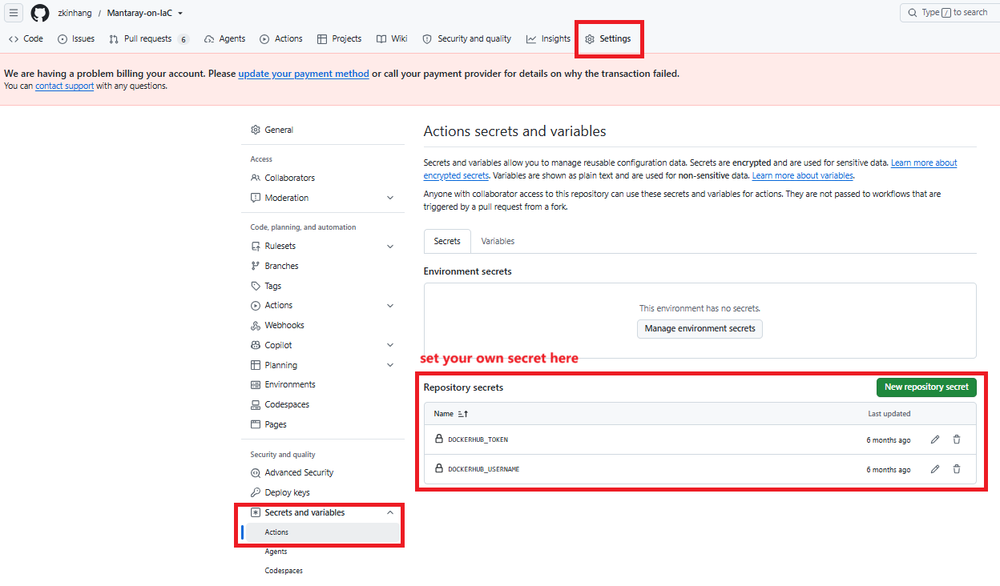

# CI/CD pipeline

A single GitHub Actions workflow, `.github/workflows/main.yml`, builds and pushes all application images to DockerHub. It runs on every push to `master` and rebuilds only the images whose source paths changed. Deployment to the cluster is not part of CI — see [Updating images](../operations/updating-images.md) for the manual sync and rollout steps.

## Change detection

The `detect-changes` job uses `dorny/paths-filter` to map changed paths to three outputs:

| Output | Watched paths | Image built |
|--------|---------------|-------------|
| `common` | `docker/common/**`, `src/ros2/**`, `src/launch_file/**`, `src/webrtc_streamer/**` | `manta-ray-ros` |
| `microros` | `docker/microros/**`, `src/microRos/**` | `microros-with-esptool` |
| `webui` | `docker/webUI/**`, `src/webUI/**` | `mantaray-control-interface` |

Each build job runs only when its output is `true`. Changes outside these paths (docs, Ansible, manifests) trigger no builds.

## Build jobs

| Job | Runner | Dockerfile | Platforms | Pushed tag |
|-----|--------|------------|-----------|------------|
| `build-main-image` | `ubuntu-latest` | `docker/common/Dockerfile` | `linux/amd64,linux/arm64` | `<user>/manta-ray-ros:latest` |
| `build-microros-image` | `ubuntu-24.04-arm` | `docker/microros/Dockerfile` | `linux/arm64` | `<user>/microros-with-esptool:latest` |
| `build-webui-image` | `ubuntu-latest` | `docker/webUI/Dockerfile` | `linux/amd64` | `<user>/mantaray-control-interface:latest` |

The micro-ROS job runs on a native ARM runner (`ubuntu-24.04-arm`) rather than emulating arm64 under QEMU, which keeps the firmware/toolchain build fast. The main image is multi-arch because it runs on both the amd64 land PC and the arm64 ROV nodes.

## GitHub secrets

Two repository secrets are required (Settings → Secrets and variables → Actions):

| Secret | Used for |
|--------|----------|
| `DOCKERHUB_USERNAME` | DockerHub login **and** the image namespace — tags are built as `${{ secrets.DOCKERHUB_USERNAME }}/<image>:latest` |
| `DOCKERHUB_TOKEN` | DockerHub login password — use an access token, not the account password |

> Note: When forking or moving the repo to a different DockerHub account, it requires updating the secret and `ansible/vars/deployment-vars.yaml` must then point at the new namespace (or the local registry) to match. As well as the subsequent local registry sync command.

## Image versioning

Currently, all images are tagged `:latest` only , there is no version tagging in the pipeline but designed. Consequences:

- Every push to `master` overwrites the previous `:latest` on DockerHub; there is no rollback tag.
- Nodes re-pull the new digest only when pods are recreated — `force_restart=true` on `playbook-app.yaml` is what guarantees this (see [Updating images §4](../operations/updating-images.md#4-roll-out-the-update)).
- To pin a version, tag manually at build or `skopeo copy` time and set that tag in `deployment-vars.yaml`.

## What CI does not do

- No push to the local registry — `skopeo copy` to `mantaray.local:5000` is manual ([Updating images §2](../operations/updating-images.md#2-sync-images-to-the-local-registry)).
- No deployment — the cluster is updated only by running `playbook-app.yaml`.
- No builds on pull requests — the workflow triggers on `push` to `master` only, so PRs are not build-tested.

## Related guides

- [Updating images](../operations/updating-images.md)
- [Architecture — containerization](../architecture.md#layer-2--containerization-docker)