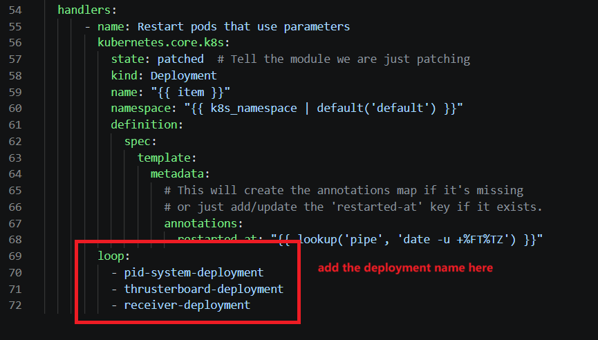
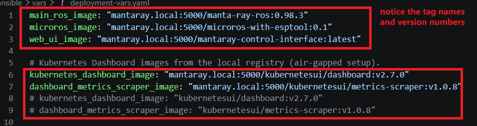

# Configuration updates

This guide covers changing application configuration without rebuilding images or reinstalling the cluster. Three files control different layers of configuration, and which one you edit determines whether a restart is needed.

## 1. Choose the right file

| File | Controls | Examples |
|------|----------|----------|
| `ansible/config/robot_params.json` | ROS node runtime parameters, delivered to pods via the `robot-parameters` ConfigMap | PID gains and setpoints, thruster mapping and direction matrices, gripper PWM values, AHRS serial port and topics |
| `ansible/vars/deployment-vars.yaml` | Container image tags and the `all_app_deployments` restart list | `main_ros_image`, `microros_image`, `web_ui_image` |
| `ansible/vars/hardware-paths.yaml` | Host device and file paths mounted into pods | camera devices (`/dev/video1`), IMU (`/dev/imu`), micro-ROS serial port, X11 socket |

## 2. Update runtime parameters (`robot_params.json`)

Edit `ansible/config/robot_params.json`, then run:

```bash
uv run ansible-playbook -i ansible/inventory.ini ansible/playbook-app.yaml
```

The playbook loads the JSON into the `robot-parameters` ConfigMap (`ansible/k8s/robot-configmap.yaml.j2`). When the ConfigMap changes, a handler automatically restarts the three deployments that consume it:

- `pid-system-deployment`
- `thrusterboard-deployment`
- `receiver-deployment`

No `force_restart` is needed. This is the fast path for tuning PID values, thruster mapping, or gripper settings.

> Note: only the three deployments above are restarted by the handler. If you add a new deployment that mounts the ConfigMap, add its name to the handler loop in `ansible/playbook-app.yaml`.



## 3. Update image tags (`deployment-vars.yaml`)

To choose which version of image to use, edit the image variables in `ansible/vars/deployment-vars.yaml`, then run with `force_restart`:



```bash
uv run ansible-playbook -i ansible/inventory.ini ansible/playbook-app.yaml -e "force_restart=true"
```

`force_restart` is required here for two reasons: the new tag must be rendered into the pod spec, and `force_restart` patches every deployment in `all_app_deployments` with a restart annotation so all pods pull the new image and restart cleanly.

See [Updating images](updating-images.md) for building and pushing images to the local registry.

## 4. Update hardware paths (`hardware-paths.yaml`)

Edit `ansible/vars/hardware-paths.yaml` when devices move — for example a camera enumerating as `/dev/video2` instead of `/dev/video1`, or a different USB serial port. These values are rendered into volume mounts in `ansible/k8s/manta-ray-deployment.yaml.j2`.

```bash
uv run ansible-playbook -i ansible/inventory.ini ansible/playbook-app.yaml -e "force_restart=true"
```

`force_restart` is required because the changed pod spec only takes effect on pods that are recreated.

## Quick reference: do I need `force_restart`?

| Change | Command |
|--------|---------|
| `robot_params.json` only | `playbook-app.yaml` (handler restarts the 3 parameter consumers) |
| Image tags in `deployment-vars.yaml` | `playbook-app.yaml -e "force_restart=true"` |
| `hardware-paths.yaml` | `playbook-app.yaml -e "force_restart=true"` |
| Pod spec in `manta-ray-deployment.yaml.j2` | `playbook-app.yaml -e "force_restart=true"` |

## Related guides

- [Managing applications](managing-applications.md) — adding and removing deployments
- [Updating images](updating-images.md) — image builds and registry sync
- [Ansible automation](../components/ansible-automation.md) — playbook reference