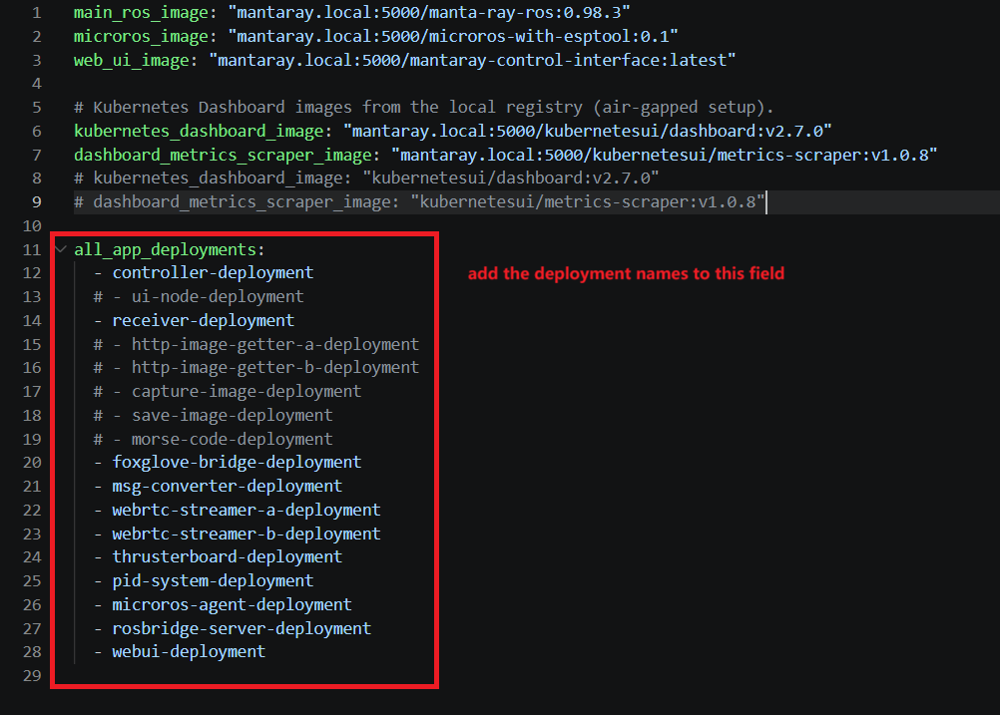
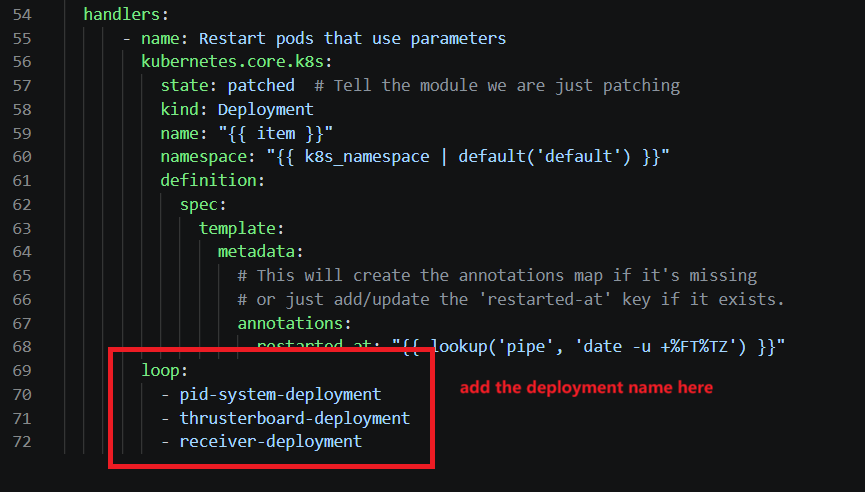
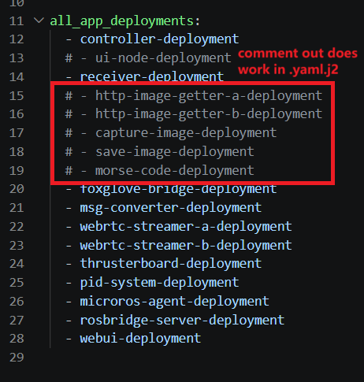

# Managing applications

This guide covers adding, modifying, and removing application deployments on the cluster. All changes go through `playbook-app.yaml`, which renders `ansible/k8s/manta-ray-deployment.yaml.j2` and applies it. It assumes the cluster is running — see [Full cluster setup](../getting-started/full-cluster-setup.md).

## 1. How deployments are defined

Two files control what runs:

- `ansible/k8s/manta-ray-deployment.yaml.j2` — the manifest template. Every `Deployment` document in it is applied unconditionally; there is no enable/disable flag.
- `ansible/vars/deployment-vars.yaml` — `all_app_deployments` lists the deployments that `force_restart` will restart. It does **not** control what gets deployed.

> Note: the playbook only applies resources (`state: present`) — it never deletes them. Removing a deployment is always a manual step (§4).

## 2. Modify an existing deployment  
  
What you change determines which file to edit:  
  
| Change | Edit | Then run |  
|--------|------|----------|  
| Application source code (`src/ros2/**`, `src/microRos/**`, `src/webUI/**`) | Rebuild and push the image — see [Updating images](updating-images.md) | `playbook-app.yaml -e "force_restart=true"` |  
| Runtime parameters (PID, thruster mapping, gripper) | `ansible/config/robot_params.json` | `playbook-app.yaml` — see [Configuration updates](configuration-updates.md) |  
| Image tag | `ansible/vars/deployment-vars.yaml` | `playbook-app.yaml -e "force_restart=true"` — see [Updating images](updating-images.md) |  
| Pod spec (args, volumes, nodeSelector, env, hostNetwork) | `ansible/k8s/manta-ray-deployment.yaml.j2` | `playbook-app.yaml -e "force_restart=true"` |  
  
> Note: application code runs inside container images — editing source files alone changes nothing on the cluster. The code must be rebuilt into an image (via CI on push to `master`, or manually), synced to the local registry in `eth` mode, and rolled out with `force_restart`. The full flow is in [Updating images](updating-images.md)

## 3. Add a new deployment

1. Add a `Deployment` document to `ansible/k8s/manta-ray-deployment.yaml.j2`, following the existing conventions:
   - `hostNetwork: true` + `hostIPC: true` for ROS2 nodes (required for DDS discovery)
   - `nodeSelector` with a `ros2-hardware` label matching the target node (see [Architecture — node labels](../architecture.md)), to indicate this application will run on which node
   - `privileged: true` and device volume mounts if it accesses hardware (paths from `ansible/vars/hardware-paths.yaml`)
   - a `parameter-volume` mount if it reads `robot_params.json`
2. Add the deployment name to `all_app_deployments` in `ansible/vars/deployment-vars.yaml` so `force_restart` covers it.



3. If it consumes the `robot-parameters` ConfigMap, add its name to the restart handler loop in `ansible/playbook-app.yaml` — otherwise parameter-only updates won't restart it.



4. Run `playbook-app.yaml -e "force_restart=true"`.

## 4. Disable or remove a deployment

1. Remove or comment out its `Deployment` document in `ansible/k8s/manta-ray-deployment.yaml.j2`.
2. Remove or comment out its name from `all_app_deployments` in `ansible/vars/deployment-vars.yaml`.



3. Delete the running resource manually — the playbook never removes anything, or do it in kubernetes dashboard, see [Set up the Kubernetes Dashboard](../getting-started/full-cluster-setup.md#7-set-up-the-kubernetes-dashboard):

   ```bash
   kubectl delete deployment <deployment-name>
   ```

To temporarily stop a deployment without removing it, scale it instead:

```bash
kubectl scale deployment <deployment-name> --replicas=0
```

> Warning: scaling to 0 is not persistent — the next `playbook-app.yaml` run re-applies `replicas: 1` from the template.

## 5. Verify

```bash
kubectl get pods -A -o wide
kubectl rollout status deployment/<deployment-name>
```

`-o wide` shows which node each pod landed on — useful for checking `nodeSelector` placement.
>Note: using kubernetes dashboard is way more visible and user-firendly.

## Related guides

- [Configuration updates](configuration-updates.md) — `robot_params.json` and `hardware-paths.yaml` changes
- [Updating images](updating-images.md) — image builds, registry sync, rollout
- [Ansible automation](../components/ansible-automation.md) — playbook reference