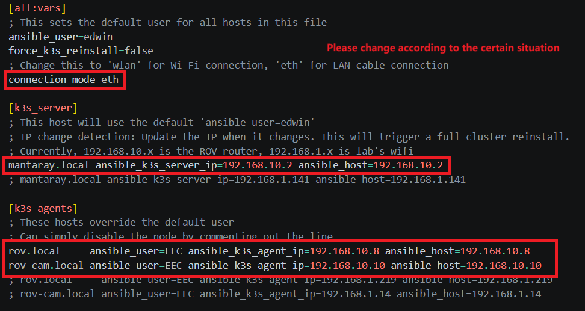
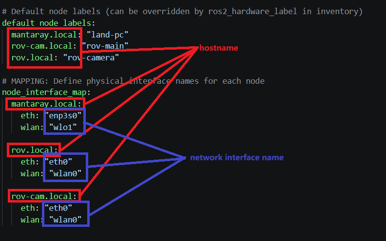
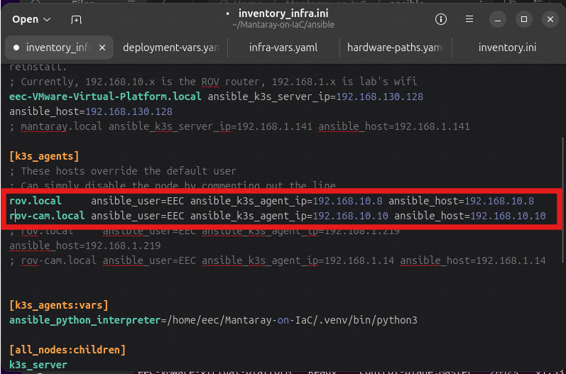

# Network switching  
  
This guide reconfigures the cluster when network interfaces or IP addresses change — for example switching between Ethernet (`eth`) and Wi-Fi (`wlan`), moving nodes to a new subnet, or recovering from connectivity issues. It assumes the cluster was installed following [Full cluster setup](../getting-started/full-cluster-setup.md).  
  
> Warning: the values of hostnames and network-interface names in `ansible/inventory_infra.ini` and `ansible/vars/infra-vars.yaml` must agree. Update both files together.

## 1. Update the infrastructure inventory  
  
Edit `ansible/inventory_infra.ini`:  
  
- Set `connection_mode` to `eth` or `wlan`, depending on whether the nodes connect via Ethernet or Wi-Fi.  
- Set `ansible_k3s_server_ip` to the server's new IP address.  
- Set `ansible_k3s_agent_ip` to each agent's new IP address.  
- Set `ansible_host` on each host line to the same new IP address.  



Then edit `ansible/vars/infra-vars.yaml`:  
  
- Confirm `node_interface_map` maps each hostname and connection mode to the correct Linux network-interface name (e.g., `eth0`, `wlan0`).  



Note: To obtain the IP addresses, use `ip addr show` on each node or check the router's client list. Assigning static IP addresses to all nodes is recommended.  
  
## 2. Run the network-switch playbook  
  
```bash  
uv run ansible-playbook -i ansible/inventory_infra.ini ansible/playbook-network-switch.yaml
```

**When to run it:**
- Changing the network interface (e.g., `eth0` → `wlan0`)
- Changing node IP addresses
- Switching between networks
- **Encountered into any network connection issue, run this playbook to reconfigure it.**

The playbook updates node-ip settings and flannel interface bindings so all nodes can communicate on the new network.

## 3. Fix kubectl permissions

After running this playbook, you **must** fix kubectl permissions:

```bash
bash kube_permission.sh
```

## 4. Redeploy the applications

```bash
uv run ansible-playbook -i ansible/inventory.ini ansible/playbook-dashboard-setup.yaml
```

The playbook will output:
- Dashboard URL
- Path to the admin token file (`dashboard-admin-token.txt`)

Please refer back to [Set up the Kubernetes Dashboard](../getting-started/full-cluster-setup.md#7-set-up-the-kubernetes-dashboard) for details on the dashboard URL and login token.

## 6. Verify the cluster

```bash
kubectl get nodes  
kubectl get pods -A
```



All enabled nodes should appear as Ready with their new IP addresses, and application pods should return to Running.
