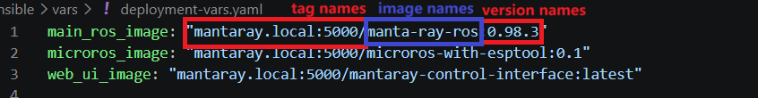

# Updating images

This guide covers building new application images, publishing them, and rolling them out to the cluster. Three images exist: `manta-ray-ros` (amd64 + arm64), `microros-with-esptool` (arm64), and `mantaray-control-interface` (amd64), they are built from the Dockerfiles in `docker/`. See [Architecture](../architecture.md#layer-2--containerization-docker) for the image contents and [CI/CD pipeline](../components/cd-pipeline.md) for automated builds.

## 1. Build and push the images

**Option A — CI (recommended).** Push to `master`. GitHub Actions rebuilds only the images whose source paths changed and pushes them to DockerHub as `:latest`.

**Option B — manual build.** The commands in `build_and_copy_to_local_registry.sh` at the repository root show the exact build invocations:

```bash
# Note that the tag names and version names/numbers are possible to customize
# Main ROS image (multi-arch: land-pc amd64 + ROV nodes arm64)
docker buildx build --platform linux/amd64,linux/arm64 \
  -f docker/common/Dockerfile -t zkinhang/manta-ray-ros:latest --push .

# Micro-ROS agent image (arm64 only)
docker buildx build --platform linux/arm64 \
  -f docker/microros/Dockerfile -t zkinhang/microros-with-esptool:latest --push .

# Web UI image (amd64 only)
docker buildx build --platform linux/amd64 \
  -f docker/webUI/Dockerfile -t zkinhang/mantaray-control-interface:latest --push .
```

Note: `build_and_copy_to_local_registry.sh` is a reference snippet, not a runnable script. Run the commands you need individually.

## 2. Sync images to the local registry

In `eth` (air-gapped) mode the nodes cannot reach DockerHub, so images must be copied into the local registry at `mantaray.local:5000`. Run `skopeo copy` from a machine that can reach both DockerHub and the registry — typically the control workstation while connected in `wlan` mode (the land PC itself):

```bash
skopeo copy --all \
  docker://docker.io/zkinhang/manta-ray-ros:latest \
  docker://mantaray.local:5000/manta-ray-ros:latest \
  --dest-tls-verify=false

skopeo copy --all \
  docker://docker.io/zkinhang/microros-with-esptool:latest \
  docker://mantaray.local:5000/microros-with-esptool:latest \
  --dest-tls-verify=false

skopeo copy --all \
  docker://docker.io/zkinhang/mantaray-control-interface:latest \
  docker://mantaray.local:5000/mantaray-control-interface:latest \
  --dest-tls-verify=false
```

`--all` copies every architecture in the manifest list — required for `manta-ray-ros`, which runs on both amd64 and arm64 nodes. `--dest-tls-verify=false` is needed because the local registry serves plain HTTP.

It is possible to skip this step entirely if the nodes pull directly from DockerHub (but normally can't) (`zkinhang/...` image sources) — see [Full cluster setup §3](../getting-started/full-cluster-setup.md#3-select-the-application-image-source).

## 3. Update the deployment variables

Edit `ansible/vars/deployment-vars.yaml` so the image references match what you pushed:

```yaml
main_ros_image: "mantaray.local:5000/manta-ray-ros:latest"
microros_image: "mantaray.local:5000/microros-with-esptool:latest"
web_ui_image: "mantaray.local:5000/mantaray-control-interface:latest"
```

To pin a specific version instead of tracking `:latest`, tag the image at build/copy time (e.g., `manta-ray-ros:0.98.4`) and set that tag here.



## 4. Roll out the update

```bash
uv run ansible-playbook -i ansible/inventory.ini ansible/playbook-app.yaml -e "force_restart=true"
```

`force_restart` is required: it patches every deployment in `all_app_deployments` with a restart annotation so all pods are recreated and pull the new image. Without it, pods keep running the old image — see [Configuration updates](configuration-updates.md#quick-reference-do-i-need-force_restart).

> Note: with a `:latest` tag, `force_restart` is what guarantees nodes re-pull the image rather than reuse a cached copy.

## 5. Verify

Confirm the running image on a node:

```bash
kubectl get deployment <deployment-name> -o jsonpath='{.spec.template.spec.containers[0].image}'
```

## Related guides

- [Configuration updates](configuration-updates.md) — parameter and hardware-path changes
- [Managing applications](managing-applications.md) — adding and removing deployments
- [Offline / Air-Gap mode](../components/offline-airgap.md) — local registry setup